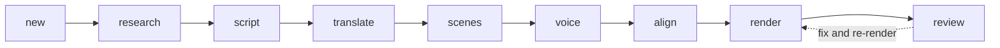

# talkreel

Turn any repo, doc or idea into a narrated explainer video or portrait reel. Free, local, with EN/FR voices and an own-voice Arabic path, built by AI agents.

## Your talks stay yours

A talk lives in `talks/<slug>/` (start one with `talkreel new <slug>`). Git ignores the whole `talks/` folder, so scripts, scenes, audio and videos stay on your machine and are never committed to this repo.

## Why it exists

- **Free.** No paid APIs and no API keys. The only thing you pay for is your Claude Code subscription. Voice, captions and rendering run on open-source tools.
- **Local and agent-native.** Everything runs on your machine, and renders work offline. Claude Code drives the pipeline through a skill, and every stage reads and writes plain files, so you can edit anything and resume.
- **Honest sources.** Every figure and quote carries an `[s:id]` marker that points into `sources.json`. `talkreel check` fails on an unknown id and on a stat or quote block with no source.

## How it works

Claude does the judgment work (research, script, translation, scenes, visual review). The `talkreel` CLI does the mechanics (voice, align, render, frames).



| Stage | Who | Output |
|---|---|---|
| new | CLI | `talks/<slug>/talk.json` |
| research | Claude | `sources.json` (URL, verbatim quote, date) |
| script | Claude | `script/en/NN-<chapter>.md` |
| translate (optional) | Claude | `script/fr/` |
| scenes | Claude | `scenes/NN-<chapter>.html`, then `talkreel check` |
| voice | CLI | `audio/<lang>/NN.wav` (Kokoro, or your own recordings) |
| align | CLI | `captions/<lang>/NN.json` (script spelling, Whisper timing) |
| render | CLI | `out/<slug>-<lang>.mp4` (HyperFrames, FFmpeg) |
| review | Claude | frames checked and fixed, at most 3 rounds |

Scenes never contain seconds. They anchor to cue words (`{#cue}` in the script, `data-cue` in the scene), so a chapter stays in sync when its audio length changes.

Scenes are built from the default theme's blocks (`themes/default/blocks.md`). They include titles, lists, quotes, stats, code, Mermaid diagrams with step-by-step reveals, and:

- a terminal with typed prompts, streamed output, tool calls, diffs and auto-scroll
- a stage pipeline whose rail fills as stages light up

Every animation is a deterministic tween on one paused timeline, so any frame renders the same at any worker count.

## Requirements

- Node.js 22 or newer
- FFmpeg (Windows: `winget install Gyan.FFmpeg`)
- [uv](https://github.com/astral-sh/uv) and Python 3.11
- [Claude Code](https://code.claude.com)

Everything runs on the CPU. No GPU is needed.

## Install

```bash
git clone https://github.com/mohamedzhioua/talkreel
cd talkreel
npm install && npm run build && uv sync --project py
node dist/cli.js doctor
```

`doctor` checks Node, FFmpeg, uv, Python 3.11 and the models. Exit code 2 means a tool is missing. Models download on first use.

To load talkreel as a Claude Code plugin (the repo has `.claude-plugin/plugin.json` and `skills/talkreel/`), start Claude Code with `claude --plugin-dir /path/to/talkreel`. See the [Claude Code plugin docs](https://code.claude.com/docs) for installing it permanently.

## Quickstart

With the skill, tell Claude Code: "make a talk about X". It creates the talk, runs each stage, and stops twice: after the script (you edit it) and after the review (you watch the video).

By hand:

```bash
node dist/cli.js new my-talk --title "My talk"
# write sources.json, script/en/*.md and scenes/*.html in talks/my-talk/
node dist/cli.js check  --talk talks/my-talk
node dist/cli.js voice  --talk talks/my-talk
node dist/cli.js align  --talk talks/my-talk
node dist/cli.js render --talk talks/my-talk --quality draft
node dist/cli.js frames --talk talks/my-talk
node dist/cli.js status --talk talks/my-talk
```

Without `--talk`, the CLI expects `talk.json` in the current directory. `voice`, `align`, `render` and `frames` take `--lang` and `--chapter NN`.

## Your own voice

Record one WAV per chapter as `audio/<lang>/NN.wav` and set `"mode": "own"` under `voice` in `talk.json`. Still run `voice`: in this mode it never synthesizes, it only converts your files to the canonical format in `build/`. Your originals are not touched.

Use a quiet room, a consistent microphone distance and 48 kHz WAV, one take per chapter. Own voice is the primary choice for male French and all Arabic.

## Reels

```bash
node dist/cli.js new my-reel --title "My reel" --reel
```

This scaffolds a portrait (1080×1920) talk, `assets/` and one chapter with a hook, photo proof, benefits list and CTA. Add your own `assets/proof.jpg` and `assets/logo.svg` before `check`, replace the sample copy and URL, and choose your voice. The voice defaults stay the same as a normal talk. Aim for 30–45 seconds; hold the fully entered CTA for at least 1.5 seconds.

Prefer the largest photos. Use full-bleed product shots with `figure data-fit="cover"` (a composer-owned backdrop and scrim; figcaption stays in the stage) and checklist ticks with `data-check` on cued `<li>` items. Take stills from clips with your own tool: 1024×576 clips are landscape material and crop heavily in portrait. M3 has no video block. Crop UI screenshots around the task and use a `device` block for a focused zoom or click.

Keep text, logos and actions inside the 936×708 stage (x 72..1008, y 340..1048). Only photography should extend under the platform's top 14%, bottom 35% and side 6% zones. Inspect a draft with `frames --safe-zones`. For portrait talks, `status` prints one length table per report, with one row per language. It totals canonical narration WAV durations when every chapter's voice stage is fresh and its WAV is readable; otherwise it estimates the whole language at 150 spoken words/minute. Each row labels its source as `voiced` or `estimate`: over 90 s warns “long for a reel” and over 180 s also warns “over the Shorts limit”. Warnings do not fail the command; check the final MP4's actual length too. See the [reel authoring guide](skills/talkreel/references/reel.md).

## Arabic

Arabic uses **your own voice + Whisper alignment + RTL layout**. Set `languages` to `["ar"]`, `voice` to `{"mode":"own"}`, write `script/ar/NN-<chapter>.md`, and record `audio/ar/NN.wav`. Run `voice`, `align` and `render` as usual. Arabic pages use IBM Plex Sans Arabic, RTL text and isolated caption words; code and terminals remain LTR. Tashkeel can stay in scripts, while captions strip harakat for display. Spell numbers out for alignment; display forms such as `[[٣|ثلاثة]]` show digits in captions.

Words the aligner misses get interpolated timings. talkreel has no Arabic TTS; use your own recording.

## Voice catalogue

| Language / use | Choice | Configuration |
|---|---|---|
| English AI | Kokoro `af_heart`, the scaffold default | `"voice": {"mode":"ai", "en":"af_heart"}` |
| English male candidate | Kokoro `am_michael`, the default candidate to try for a reel | `"voice": {"mode":"ai", "en":"am_michael"}` |
| French AI | Kokoro `ff_siwis` | `"voice": {"mode":"ai", "fr":"ff_siwis"}` |
| Male French; all Arabic | Your recording, primary choice | `"voice": {"mode":"own"}` and `audio/<lang>/NN.wav` |

Bare voice ids select Kokoro. Match the voice language to the script and listen before a full run. There is no audition command yet: voice one short chapter and listen. Own recordings and Kokoro audio have no embedded audio watermark. Additional engines and their credits arrive separately.

## Music and loudness

Supply a music bed you have permission to use, inside the talk's `assets/`, and add this to `talk.json`:

```json
"music": {
  "file": "assets/bed.wav",
  "credit": "Track title — artist",
  "license": "Your licence or permission",
  "gainDb": -18
}
```

`render` loops and trims the bed, ducks it under the narration, fades its tail, then applies two-pass loudness normalisation targeting **−14 LUFS integrated**, **−1.5 dBTP** true peak and LRA 11. `gainDb` defaults to −18 (allowed −60..0). Music changes rerun the mix without re-rendering scenes. `status` shows the mix stage; `out/credits.txt` records music, voice/watermark and fonts.

**A talk without music is not loudness-normalised.** The `voice` command's own-recording conversion changes format, not loudness; there is no standalone `--normalize` flag yet.

## French

Add `"fr"` to `languages` in `talk.json`, then run the translate stage (Claude writes `script/fr/` from the English script). The default French voice is `ff_siwis`. Kokoro's French is serviceable, not great; M1 proves it on a short sample.

## Performance, honestly

Rendering runs at about 4x realtime on an 8-thread laptop CPU, so a 10-minute talk takes about 40 minutes. Only chapters whose inputs changed are re-rendered. Use `--quality draft` while iterating; `render` refuses to join draft and standard chapters.

## Talk folder layout

```
talks/<slug>/
  talk.json          title, languages, voice, theme, fps, resolution
  sources.json       sources with ids, URLs, quotes, dates
  script/<lang>/     NN-<chapter>.md
  scenes/            NN-<chapter>.html
  assets/            local photos, screenshots, logos and optional music bed
  audio/<lang>/      NN.wav (generated, or yours)
  captions/<lang>/   NN.json word timings
  build/             per-chapter HyperFrames projects (generated)
  out/               <slug>-<lang>.mp4, chapters.txt, transcript.md
  talk.state.json    input hashes, decides what is stale
```

## Roadmap

M3 adds portrait authoring, local images, RTL captions, device and CTA blocks, checklist ticks, full-bleed cover figures and music mixing. CTC alignment follows in a later PR. An experimental voice engine with auditions may follow; video blocks, count-up animation and chat are deferred. See [the M3 roadmap](docs/roadmap/m3-reels-tasks.md).

## Licence and credits

MIT, see `LICENSE`. [THIRD_PARTY.md](THIRD_PARTY.md) lists dependencies. One note: the Kokoro audio chain pulls in GPL-3.0 components (phonemizer, espeak-ng) through your own `uv sync`; talkreel never ships them.

Ideas adapted from lemo-opuscar, mg-styles-15 and ClaudeAnimationBase (all MIT), and from promo-flow (ideas only). Rendering by [HyperFrames](https://github.com/heygen-com/hyperframes) from HeyGen.
